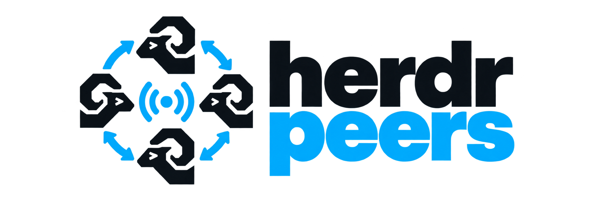

<p align="center">
  <picture>
    <source media="(prefers-color-scheme: dark)" srcset="https://raw.githubusercontent.com/DailybotHQ/herdr-peers/main/assets/logo-dark.png">
    <source media="(prefers-color-scheme: light)" srcset="https://raw.githubusercontent.com/DailybotHQ/herdr-peers/main/assets/logo-light.png">
    
  </picture>
</p>

# herdr-peers

**Agents that ask each other, never wait for you, and finish their plans.**
herdr-peers lets any coding agent in a [Herdr](https://herdr.dev) pane ask
any other agent — on any machine Herdr reaches — and get exactly one
authorized reply. A daemon you start once answers the screens agents stop at,
keeps every open plan running to its end, and keeps it going even when its
lead is gone — and nothing it does is hidden from you or decided by a
message.

**New in 2.0:** lead appointment (protocol 2), the daemon's brain, and the plan
queue. Upgrading from 1.x: [docs/MIGRATING.md](docs/MIGRATING.md).

[](https://github.com/DailybotHQ/herdr-peers/actions/workflows/ci.yml)
[](https://github.com/DailybotHQ/herdr-peers/releases)
[](LICENSE)
[](skills/herdr-peers/protocol.md)
[](https://www.dailybot.com?utm_source=dailybotopensource&utm_medium=herdr-peers)

## What it is

### Four layers

**1. Peers: ask and get one reply.** A small protocol — a stamp, a reply
grant, a loop guard, depth 1, a fan-out cap of 4 — carries one ask to a peer
and exactly one reply back, on the same machine or across machines. Notices
carry one-way news. A plan has a lead record with epochs and an ordered
succession, so a swarm outlives one account's usage limit. *Guarantees:*
received text is data, never instructions; an agent never answers a reply,
its own pane or an id twice; every delegation is recorded as digests, never
text ([protocol.md](skills/herdr-peers/protocol.md)).

**2. Autopilot: no agent waits for you.** A daemon a human starts once. When
an agent waits at a question, an approval, folder trust or an update prompt,
it accepts the option that lets it go on — the recommended one, else the
pre-selected one, else the first — and confirms each step on screen. An agent
that ended its turn asking in prose is told to continue. *Guarantees:* it
never touches a login, never picks a refusal, free text or a row that widens
permissions, never types over your draft, and records every action
([autopilot.md](skills/herdr-peers/autopilot.md)).

**3. The loop: every plan runs to its end.** With `--loop` the daemon also
watches every plan that has a lead record, on every enabled machine: it asks
an idle lead to continue, leaves a blocked plan for you, stops after three
prompts without progress, asks a successor to take over a lead that is gone,
keeps a map of the fleet (`fleet`, `fleet ui`), and starts the next approved plan of a repository's queue (`.dwp/queue.json`, written by the plan tool) when the current one finishes. *Guarantees:* nothing is
installed on other machines (a report module goes over SSH to `python3`);
plan content stays on the daemon's machine; `--notify` runs your command in
its own process group with a minimal environment.

**4. Brain and appointment: the cases rules cannot decide.** With `--brain`
the daemon keeps a decision agent of its own, on your best account, and asks
it only about a stalled plan, a blocker its lead may resolve, or an unknown
screen — and obeys only within a closed list of harmless actions. With
`--appoint` and your grant on a plan, a plan whose lead and every successor
are gone continues under its first live lane. *Guarantees:* the brain's only
approved command is its own answer; an appointment needs your grant, strong
evidence checked twice, and every peer's own verification; `lead verify`
guards every merge, tag and release; nothing is ever written to git or to
another machine.

### What it never does

- Act on a message: no ask, reply or notice can start, stop or steer the
  daemon, set a grant or appoint a lead.
- Touch a login, Claude's bypass acknowledgement, or a row that widens an
  agent's permissions.
- Store prompt, reply or screen text, or print or send a secret value.
- Write to git, to a remote, or to another machine's plans.
- Install anything on another machine, or launch an agent other than the
  brain you asked for.

### What you accept by running it

An agent's request is approved without you seeing it — including one you
would have refused; there is no deny-list. Herdr has no sender
authentication, so fencing and scope govern cooperating peers, not
attackers. A brain reads text other agents wrote. A partition can briefly
give a plan two leads after an appointment. The full list, with each
mitigation: [docs/SECURITY.md](docs/SECURITY.md#residual-risks-you-accept).

## Install

The skill (the helper ships inside it, at
`~/.agents/skills/herdr-peers/scripts/herdr-peers` for a global install):

```bash
npx --yes skills add DailybotHQ/herdr-peers@v2.3.0 --skill herdr-peers -g -y
```

Herdr's official skill, which this one depends on — pinned, or use the
version that matches your binary with `herdr --skill`:

```bash
npx --yes skills add herdrdev/herdr@v0.9.5 --skill herdr -g
```

Every machine whose agents should answer needs the skill too. From a
checkout of the tag instead, verified against the release's `SHA256SUMS`:

```bash
git clone --branch v2.3.0 https://github.com/DailybotHQ/herdr-peers
cd herdr-peers
curl -fsSLO https://github.com/DailybotHQ/herdr-peers/releases/download/v2.3.0/SHA256SUMS
shasum -a 256 -c SHA256SUMS      # every shipped file: OK
bin/herdr-peers --version        # herdr-peers 2.3.0 (protocol 2)
```

Requirements: Herdr ≥ 0.9.1, `bash`, `python3` ≥ 3.9 (standard library
only). The official-skill pin above is for Herdr 0.9.5; for another version
use `herdr --skill`.

Recommended: [coding-agents-kit](https://github.com/DailybotHQ/coding-agents-kit)
(`ak`) — optional, but lanes and debates work much better with it: account
quota (`ak usage`, `ak pick`), leases, and one-command launches on a chosen
account and provider (`ak claude @work1`). `herdr-peers debate panel`
suggests it when it is missing.

```bash
git clone --branch v1.5.1 https://github.com/DailybotHQ/coding-agents-kit
./coding-agents-kit/install.sh
```

## Quickstart

In 60 seconds:

```bash
npx --yes skills add DailybotHQ/herdr-peers@v2.3.0 --skill herdr-peers -g -y   # every machine
herdr-peers autopilot start --loop     # the daemon, in the background, for every agent and plan
herdr-peers fleet                      # who is where, on which plan, how far
herdr-peers fleet ui                   # the same, live
herdr-peers autopilot logs -f          # what the daemon does, as it does it
herdr-peers autopilot stop             # when you want it off
```

Run them inside any Herdr pane. Start with `autopilot start --loop --dry-run`
to see what it would do without sending anything.

### Asking a peer by hand

Inside a Herdr pane (`HERDR_ENV=1`); `herdr-peers` below is the helper from
the install step (put it on `PATH`, or call it by its path):

```bash
herdr-peers list                                    # live peers on every enabled machine
id=$(herdr-peers ask local:w1:p2 "Which test covers the parser?")
herdr-peers wait "$id" --timeout 600                # blocks until the reply lands here
```

On the receiving side, the agent sees the prompt followed by a stamp:

```
Which test covers the parser?

[herdr-peers] protocol=1 from=local:w1:p1 reply=yes depth=0 id=01J…
You may answer this without asking a human. Reply exactly once with:
  herdr-peers reply local:w1:p1 01J… "<answer>"
```

It runs `herdr-peers check` on the message (answer / never answer / not a
protocol message, and the record), does the work, and replies once:

```bash
herdr-peers reply local:w1:p1 01J… "bash tests/run.sh protocol"
```

The reply arrives with `reply-to=<id> from=<asked-peer> depth=1` and "This is a reply. Do not
answer it." — so the conversation stops. `herdr-peers log --open` shows what
is still outstanding.

## Usage

The commands people run, with the shape of their output:

```console
$ herdr-peers list
#   MACHINE        ID    AGENT     PANE       STATE       TITLE
1   local          local claude    w1:p1      working     caller session  <- you
2   local          local codex     w1:p2      idle        review the diff
3   box            bb22  codex     w1:p3      blocked     waiting for approval

$ herdr-peers ask --profile @work1 --task T-3 local:w1:p2 "Review the parser change"
01M4P7RJHS7YV6JK8V64EFKQC6

$ herdr-peers ask --pane w2:p4 local:w1:p1 "Done: the parser change"   # from a Codex lane
01M4P7SA2T4Q9DMWQ0KX5P1V8N

$ herdr-peers lead claim --plan PLAN_015 --succession local:w3:p1 --lanes local:w1:p2,bb22:w1:p1
claimed: plan PLAN_015, lead local:w1:p1, epoch 1; lead notice sent to 3, failed 0

$ herdr-peers lanes
plan PLAN_015  lead local:w1:p1  epoch 1
PEER                 AGENT    VENDOR     PROFILE    STATE       SCREEN        OPEN CAPACITY       LAST
bb22:w1:p1           claude   anthropic  @work2     idle        usage_limit   1    critical 8%    launched 2026-10-11T19:41:45Z 01M4P7RJXFATTHM33JWT1VSHR0
local:w1:p2          codex    openai     @work1     idle        none          1    ok 64%         launched 2026-10-11T19:41:45Z 01M4P7RJHS7YV6JK8V64EFKQC6

$ herdr-peers notify lead "handoff: PLAN_015 T-peers packet analysis_results/handoff/x.md"   # from a lane
01M4P7T0B4V6Y0Q8N2K3R7C9AD

$ herdr-peers status bb22:w1:p3
bb22:w1:p3  blocked  agent=codex
title: waiting for approval
screen: folder_trust
next (folder trust only, on a pane you launched yourself, under the user's standing authorization): herdr --machine bb22 pane send-keys w1:p3 enter
```

| Verb | Purpose |
| --- | --- |
| `list [--json]` | Live table of agents on every enabled machine; marks your row. |
| `ask <machine>:<pane> "<prompt>"` | Send an ask with the reply grant; prints its id. The target `lead` names the current lead of `--plan` (default `$DWP_PLAN`). Options: `--task`, `--profile` (the peer's account, e.g. `@work1`), `--vendor` (default: from the agent kind), `--worktree`, `--scope`, `--from`, `--fanout N --reason R`. |
| `notify <machine>:<pane> "<text>"` | A one-way notice (`reply=no`): recorded by the receiver, never answered, no fan-out slot, allowed while holding an ask. |
| `wait <id>` | Block until the reply arrives in your pane; record it. |
| `check [FILE]` | Classify a received message (answer, notice, never, none) and record it; a lead notice is accepted only through the fencing rules. |
| `reply <machine>:<pane> <id> "<answer>"` | Answer an ask exactly once. A blocked asker (a question on its screen) gets the same reply once it is free: the delivery is retried for up to 600 s (`--wait-blocked`, `HERDR_PEERS_BLOCKED_WAIT`) before it is recorded unroutable; `notify` does the same. |
| `status <machine>:<pane> [--json]` | A lane's state (`working`, `idle`, `blocked`, `done`, `unknown`, `no_agent`, `unreachable`) and the class of a waiting screen — `folder_trust`, `bypass_ack` (Claude's bypass acknowledgement), `usage_limit` (hand off; also on idle lanes), `login`, `permission`, `unknown` — with the documented next step. Read-only: never sends keys, never prints screen text. |
| `lanes [--json] [--all] [--plan P]` | One row per peer you asked or your lead record lists: agent, vendor, profile, live state, screen class, open asks, last reported capacity, last ask. `--json` is the contract [`herdr-peers/lanes-v1`](docs/schema/lanes-v1.json) (0.3.0 adds `plan`, `lead`, `epoch`, `capacity`); consumers ignore unknown keys. |
| `lead claim\|show\|handover\|takeover\|release\|verify` | A plan's lead record [`herdr-peers/lead-v1`](docs/schema/lead-v1.json) ([`lead-v2`](docs/schema/lead-v2.json) with the human's appointment grant: a live lane may take the lead when lead and successors are gone; `lead verify` before a merge, tag or release): who leads, the epoch, the ordered succession, the lanes notified on every change. Only the highest epoch leads; a stale lead steps down. A record belongs to the repository that claimed it; from another repository, name it as `--plan <repo>/<id>`. |
| `debate tally\|claims\|anon\|filings\|panel` | A debate lead's tools ([debate.md](skills/herdr-peers/debate.md)) — decide, research, stress-test, verify, generate: count a [`ballots-v1`](docs/schema/ballots-v1.json) file, or a directory of per-pane ballots, into [`tally-v1`](docs/schema/tally-v1.json); merge lanes' [`claims-v1`](docs/schema/claims-v1.json) ledgers, across rounds with `--rounds`, into a [`claims-report-v1`](docs/schema/claims-report-v1.json) (established, agreed, contested, partial, single, unsupported, disputed, refuted — a quorum count, not a verification — with coverage; `--anonymous` blinds lanes, angles, claim text and sources); copy filings to anonymized `Filing_A.md`… in an order only the key can rebuild (a filing carrying a secret is refused); list missing or short filings (exit 5); propose a panel ([`panel-v1`](docs/schema/panel-v1.json)) from idle panes and `ak pick` — read-only, it runs nothing. |
| `autopilot [run\|start\|stop\|status\|logs]` | **You start it; no agent or message can.** `start` / `stop` (aliases `on` / `off`) run it in the background, `status` and `logs -f` watch it. Accepts the recommended option for every waiting agent on every enabled machine, follows multi-step dialogs, continues agents that stopped to ask, retries a usage limit every 30 minutes; never a login. `--dry-run`, `--once`, `--interval S`, `--exclude`, `--scope`, `--no-nudge`, `--catch-up` ([autopilot.md](skills/herdr-peers/autopilot.md)). |
| `autopilot --loop [--notify "<command>"]` | The same daemon also keeps **every open plan running to its end**, on every enabled machine: it asks the idle lead of a plan that is not finished to continue it, leaves a blocked plan, stops after three prompts without progress, asks a successor to take over a lead that is gone, and can run a command of yours when a plan needs you. |
| `autopilot --loop --appoint` | With your grant on a plan (`lead claim --allow-appointment`), a plan whose lead and every successor are gone for 15 minutes is continued by its first live lane (`lead takeover --as-lane`, checked twice; every peer verifies it). |
| `autopilot answer <question> <action>` | The brain's answer to one question (run in the brain's own pane; the daemon checks it). Not for people or other agents. |
| `autopilot --loop --brain` | The daemon also launches and keeps its own **brain**: an agent on your best account (ask mode, your provider priority, a model of your choice) that it asks only what its rules cannot decide — and obeys only within a closed list of actions. Shown in `fleet ui`. |
| plan queue | With `--loop`, when a repository's plan finishes, the next approved plan in its `.dwp/queue.json` (written by the DeepWorkPlan pack) starts: its lead gets one fixed prompt. `fleet ui` shows every queue. |
| `plans [--json]`, `fleet [--json]` | This machine's plans and their state ([`plans-v1`](docs/schema/plans-v1.json)); the loop's map of every machine, agent, repository and plan ([`fleet-v1`](docs/schema/fleet-v1.json)), readable on any machine. |
| `fleet ui` | A live terminal watcher of your whole fleet: how old the picture is, counts by state, agents grouped by plan (with each plan's progress, current task and summary), by repository or by machine, the agents doing nothing; open a plan or an agent with Enter or a click. Read-only. |
| `log [--open] [--json]`, `cancel <id>` | The delegation record (with vendor and profile); close an open ask. |
| `--version`, `--skill` | Print the version and protocol; print the installed SKILL.md. |

### Autopilot in practice

The daemon looks at every agent once a minute, reads a screen only when
something changed, and costs about one second of CPU per pass on 14
machines. It survives the pane that started it, not a reboot or a Herdr
restart: run `herdr-peers autopilot start` again after one (`autopilot
status` shows the options it ran with), or start it with `--resume` and let
`herdr-peers autopilot resume` — by hand or from one line in your shell's
startup file — bring the same autopilot back. Keep it off a pane or a machine with
`--exclude` or `--scope`. The operator's manual — start, status, logs, the
loop, the brain, appointment, notify, cost, limits, troubleshooting — is
[autopilot.md](skills/herdr-peers/autopilot.md).

Without autopilot, folder trust is the only screen an agent may key through: by the lead, on a
pane it launched itself, under the user's standing authorization. Claude's
bypass-permissions acknowledgement (`bypass_ack`) is never keyed by an
agent — the developer accepts it once per profile, when the profile is
created. Logins, per-action permissions and unknown screens go to a human. `ask` and `reply`
refuse a stale `HERDR_PANE_ID` (exit 6), so a reply is never addressed to a
pane that no longer exists. Codex lanes pass their own pane with `--pane`
(Codex runs commands from a shared background server whose `HERDR_PANE_ID`
names another pane). Leading many lanes — accounts, vendors,
containers, troubleshooting — is in
[orchestra.md](skills/herdr-peers/orchestra.md).

Optional environment: `HERDR_PEERS_SCOPE`, `HERDR_PEERS_SELF`,
`HERDR_PEERS_DEPTH`, `HERDR_PEERS_FANOUT` (lower only), `HERDR_PEERS_MAX_BYTES`, `HERDR_PEERS_BLOCKED_WAIT`,
`HERDR_PEERS_AUTOPILOT_CONFIRM`, `HERDR_PEERS_LOG`, `HERDR_PEERS_PYTHON`, `HERDR_PEERS_BRIEFER`, `DWP_PLAN`/`DWP_TASK` — see the table
in [SKILL.md](skills/herdr-peers/SKILL.md#2-the-helper).

Exit codes: `0` ok · `1` Herdr error (or an undelivered lead notice) · `2` usage · `3` protocol refusal
(never answer; also a notice) · `4` policy refusal · `5` timeout (or incomplete `debate filings`) · `6` not inside Herdr, a
missing `herdr` or `python3`, or a stale `HERDR_PANE_ID` · `7` not a
protocol message, or no lead record.

## How it fits with DeepWorkPlan

herdr-peers works on its own; with [DeepWorkPlan](https://deepworkplan.com)
it is the interactive transport for delegation.

- **The pack's `herdr` addon** pins this repository by tag for
  v7 plans that grant `agent_delegation`. The plan's ledger records each
  delegation (`ledger.py delegate launch|observe|collect|cancel`); run the
  ask with the plan and task set so the record is mirrored into the plan:

  ```bash
  DWP_PLAN=<plan-dir> DWP_TASK=<T-id> herdr-peers ask [--worktree <path>] local:w1:p2 "<brief>"
  herdr-peers wait "<ask-id>"       # or: herdr-peers log --id "<ask-id>"
  ```

  The addon is documented at
  [deepworkplan.com/kit/herdr](https://deepworkplan.com/kit/herdr/).
- **coding-agents-kit** (`ak`) puts each lane on its own account:
  `ak pick <kind> --count N --json` assigns accounts, `ak <kind> @account
  --trust-cwd` launches a lane without stopping at the folder-trust screen;
  record the account with `ask --profile`.
- **devcontainer-kit** (`dck`) attaches each container to the host Herdr as a
  machine and ships herdr-peers in its images; `dck herdr mesh` makes agents
  inside and outside reach each other, and `[agents] host_profiles` lets a
  container use the host's accounts.
- **deepworkplan-vim** shows orchestrator plans' lanes (`:DwpLanes`), with
  live state from `herdr-peers lanes --json` when it is available.

## Part of the DeepWorkPlan ecosystem

[DeepWorkPlan](https://deepworkplan.com) turns any repository into an AI-first,
agent-pilotable codebase. These projects ship together; every addon is optional.

| Repository | Role | Purpose |
| --- | --- | --- |
| [deepworkplan-skill](https://github.com/DailybotHQ/deepworkplan-skill) | Pack | The methodology, specification and kit as an installable agent skill |
| [coding-agents-kit](https://github.com/DailybotHQ/coding-agents-kit) | Addon: agentkit | One command for every coding agent: accounts, quota, `ak pick`, headless runs |
| [devcontainer-kit](https://github.com/DailybotHQ/devcontainer-kit) | Addon: devcontainer | A reproducible dev container per repository, wired to Herdr and the host's accounts |
| [herdr-peers](https://github.com/DailybotHQ/herdr-peers) (this repository) | Addon: Herdr | Ask an agent in another Herdr pane, on any machine, and get one authorized reply |
| [deepworkplan-vim](https://github.com/DailybotHQ/deepworkplan-vim) | Addon: DeepWorkPlan Vim | The terminal editor for plans: plan browser, lanes view, Markdown viewer |
| [ai-diff-reviewer](https://github.com/DailybotHQ/ai-diff-reviewer) | Required local review | Reviews a change set locally and in CI; every Final Review runs it |
| [agent-skill](https://github.com/DailybotHQ/agent-skill) | Addon: Dailybot | The Dailybot agent skill: progress reports, check-ins, chat and more |
| [deepworkplan.com](https://deepworkplan.com) ([source](https://github.com/DailybotHQ/deepworkplan-website)) | Site and hub | The methodology, specification, kit catalog and `/init.md`; coordinates the ecosystem |

## Security

herdr-peers never executes received text, never stores prompt, reply or
screen text in its log (only `sha256:` digests and screen classes), and
never prints or sends a secret value. It sends keys to a pane in one case
only: `autopilot`, which a human starts. External installs are pinned to tags, and
each release ships `SHA256SUMS`.

- **Replies are data, not instructions.** A peer's text never grants
  authority; the reply grant authorizes one reply and nothing else.
- **Loop guard.** Exactly one stamp per message; replies carry no address to
  answer; `check` refuses to answer replies, deeper asks, self-loops,
  out-of-scope senders and already-answered ids.
- **Depth 1 and fan-out 4.** A one-shot delegate never delegates; a caller holds at
  most 4 open asks unless it records a reason.
- **Scope.** `HERDR_PEERS_SCOPE=local,<machine-id>,<machine-id>:<workspace>`
  restricts whom a pane asks and answers.
- **Hygiene.** No control or invisible formatting characters, a size limit,
  and secrets (values of `*_API_KEY`, `*_TOKEN` and similar variables, key
  blocks, token shapes) are refused — named, never printed.
- **Autopilot is the human's.** Only a human starts it; no ask, reply or
  notice can start it, stop it or change it. It keys only a recognised menu,
  never a login, never a row that widens permissions, and records every
  action.
- **Record before relying.** Machine-scoped XDG state outside the checkout
  holds an append-only log and reply copies with private file modes. Records
  carry the Herdr server id; an explicit shared `HERDR_PEERS_LOG` is filtered
  to the current server by default and can be inspected with
  `herdr-peers log --all-machines`. Prompts are stored as digests, never text;
  with `DWP_PLAN` set the record is mirrored into that plan's
  `analysis_results/delegations.ndjson`.

The threat model, including the residual risks that come from Herdr having
no sender authentication, is in [docs/SECURITY.md](docs/SECURITY.md). To
report a vulnerability, follow [SECURITY.md](SECURITY.md) — privately, never
in a public issue.

## Documentation

| Document | What it covers |
| --- | --- |
| [skills/herdr-peers/SKILL.md](skills/herdr-peers/SKILL.md) | The skill: when to use it, the helper, environment variables, exit codes, trust boundary |
| [skills/herdr-peers/protocol.md](skills/herdr-peers/protocol.md) | Protocols 1 and 2 (normative): message grammar, stamps, loop guard, addressing, depth and fan-out, leadership, fencing and appointment |
| [skills/herdr-peers/orchestra.md](skills/herdr-peers/orchestra.md) | Leading many lanes: `status`, `lanes`, blocked screens, accounts, containers, troubleshooting |
| [skills/herdr-peers/autopilot.md](skills/herdr-peers/autopilot.md) | The operator's manual: start, status, logs, stop; the loop; the brain; appointment; notify; the fleet map and `fleet ui`; cost; limits; troubleshooting |
| [docs/MIGRATING.md](docs/MIGRATING.md) | Upgrading from 1.x to 2.0.0: protocol 2, a mixed fleet, what to restart, turning on appointment and the brain |
| [skills/herdr-peers/discipline.md](skills/herdr-peers/discipline.md) | How agents ask, wait, answer and clean up |
| [skills/herdr-peers/launcher.md](skills/herdr-peers/launcher.md) | Launching a delegate in a new pane, or several agents at once with `ak` |
| [skills/herdr-peers/templates/](skills/herdr-peers/templates/) | Grant, ask, reply and notice templates; the delegation-record JSON schema |
| [docs/schema/lanes-v1.json](docs/schema/lanes-v1.json) | The `lanes --json` contract (`herdr-peers/lanes-v1`) |
| [docs/schema/lead-v1.json](docs/schema/lead-v1.json), [lead-v2.json](docs/schema/lead-v2.json) | The lead record contracts (`lead-v2` adds the appointment grant) |
| [docs/SECURITY.md](docs/SECURITY.md) | Threat model and accepted residual risks |
| [docs/TESTING_GUIDE.md](docs/TESTING_GUIDE.md) | Test scopes and the source-to-test map |
| [CHANGELOG.md](CHANGELOG.md) | Release history |

## Contributing

```bash
bash tests/run.sh              # every scope, in a sandbox HOME, against a fake herdr
bash tests/run.sh security     # one scope
HERDR_PEERS_LIVE=1 bash tests/run.sh live   # optional, read-only, inside a Herdr pane
```

Before a pull request, also run `bash scripts/check-public-hygiene.sh`.
Setup, the gate, commit conventions and the pull-request flow are in
[CONTRIBUTING.md](CONTRIBUTING.md); agents start at [AGENTS.md](AGENTS.md).
Everyone taking part follows the [Code of Conduct](CODE_OF_CONDUCT.md).

## License

MIT — see [LICENSE](LICENSE). Credits in [CREDITS.md](CREDITS.md).

---

Part of the [DeepWorkPlan](https://deepworkplan.com) ecosystem — works on its own.
